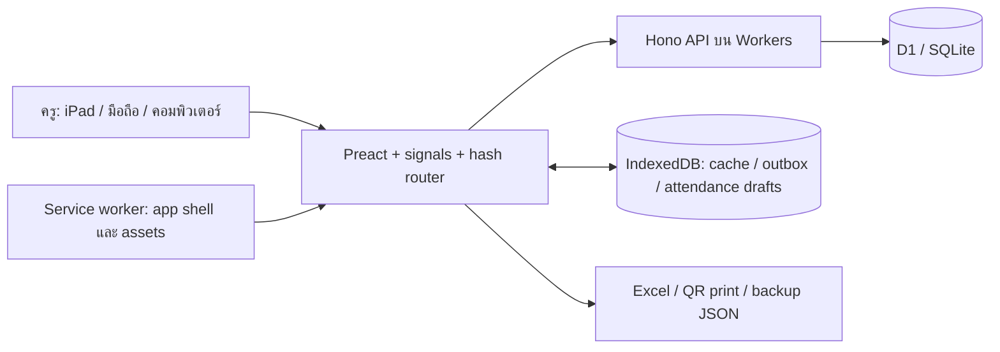

# งานครบ — แผนที่ระบบสำหรับทีมพัฒนา

สำรวจ 23 ตุลาคม 2569 จาก working tree บน `main`, HEAD `1141caf` รวมงานที่ยังไม่ commit; ไม่ใช่หลักฐานรุ่นที่ deploy อยู่จริง

อัปเดต 24 ต.ค. 2569: แก้F01–F11และเพิ่มF12เสร็จในlocalแล้ว ชุดทดสอบ554/554และnpm audit0 ดู [ผลหลังแก้](jobs/2026-10-24-hardening/verification.md) และ [สถานะปัจจุบัน](jobs/2026-10-24-hardening/board.md) ตารางbaselineด้านล่างเก็บไว้เป็นประวัติก่อนแก้

## เป้าหมายและผู้ใช้

ครูหนึ่งคนใช้หลายเครื่อง: iPad คอมพิวเตอร์ และมือถือ เริ่มทดลองหนึ่งห้องก่อนขยาย ระบบจัดการส่งงาน คะแนน เช็คชื่อ นักเรียน QR รายงาน และสำรอง/กู้คืน มีการทำงานออฟไลน์เพื่อใช้ในห้องเรียน

บริบทที่ผู้ใช้ยืนยัน24ต.ค.: ครูส่วนใหญ่สอน ป.6 และไม่สอนนักเรียนรุ่นเดิมต่อหลังเลื่อนชั้น ปีใหม่จึงเปิดห้องว่างสำหรับเด็กรุ่นใหม่ เก็บรายงานรุ่นเก่าแยกตามปี ระบบเลื่อนชั้นหรือ enrollment หลายปีไม่ใช่งานจำเป็นก่อนส่งมอบ

## สถาปัตยกรรม

| ส่วน | หน้าที่และจุดเริ่มอ่าน |
|---|---|
| Client shell | `src/main.tsx`, `src/app.tsx`, `src/router.ts`, `src/store.ts` — auth, bootstrap, onboarding, ปี/เทอมที่เลือก |
| หน้าหลัก | `src/pages/` — Home, Scan, Attendance, Gradebook, Students, Random, Reports, Settings, Setup, Onboarding |
| การเขียนออฟไลน์ | `src/lib/idb.ts`, `outbox.ts`, `attSync.ts`, `session.ts`, `reconnect.ts`; คิวคะแนนมี opId, ลำดับต่อคู่เด็ก/งาน, retry และ failed queue |
| กล้อง/เครื่องยิง | `camera.ts`, `hid.ts`, `shared/scan.ts`, `shared/keymap.ts`; native BarcodeDetector หรือ WASM ที่โฮสต์เอง |
| API | `worker/index.ts` → `worker/app.ts` → `worker/routes/`; middleware ตรวจ origin, schema, session, maintenance และ data epoch |
| ฐานข้อมูล | `migrations/0001`–`0007`; schema ปัจจุบัน **6**; classes ผูกปี แต่ students เก็บ class_id ปัจจุบันเดียว |
| ข้อมูลหลัก | terms, classes, subjects, work_types, students, assignments, assignment_classes, submissions, attendance_sessions, attendance |
| ความปลอดภัย/ระบบ | teacher, devices, sessions, login_attempts, audit_logs, meta, restore_jobs, restore_staging; บัญชีครูเดียว ยังไม่ใช่ multi-tenant |
| สำรอง/กู้คืน | backup แบบแบ่งหน้า, fingerprint ก่อน/หลัง; validate → stage chunks → atomic commit; เพิ่ม epoch หลังกู้คืน |
| Build/deploy | Vite + Cloudflare plugin, `public/_headers`, `public/sw.js`, `scripts/sw-precache.ts`, `scripts/preflight.cjs`, `wrangler.jsonc` |
| QA | Vitest DOM + Workers/D1; browser scripts ใช้ fixture server และข้อมูลสมมติ; trial reconciliation เทียบกับกระดาษ |

## คำสั่งและผลล่าสุด

| คำสั่ง | ผล 23 ต.ค. 2569 |
|---|---|
| `npm run typecheck` | PASS — QA ตรวจ current tree |
| `npm test` | PASS — 45 ไฟล์ / 496 tests; 46.33 วินาทีตาม Vitest |
| `npm run build` | PASS — มี warning Excel chunk ประมาณ 940 kB และ static/dynamic imports ปะปน |
| `npm run preflight` | PASS เฉพาะ local configuration ไม่ยืนยัน remote |
| `npm audit --json` | สำเร็จในการอ่านฐาน advisory; exit 1 เนื่องจากพบ 15 affected packages (9 high / 6 moderate) |
| `node docs/team/jobs/2026-10-23-onboard/evidence/reproduce.cjs` | ทดลองเพิ่มกับ D1 ชั่วคราว: ยืนยันบั๊ก 5 สถานการณ์ และ protected API samples ตอบ 401 |

`npm test` และ fixture server ต้องให้ runtime เปิด loopback ได้ การรันใน sandbox ครั้งแรกติด EACCES/EPERM และ module startup errors; เมื่อรันด้วยสิทธิ์ที่อนุมัติสำหรับชุดทดสอบเดิมจึงผ่าน ไม่แก้ config เพื่อกลบ test

## สิ่งที่ต้องรักษา

- งานแก้ค้างเดิมใน Scan/Gradebook/Students, CSS, lockfile, audits และ tests เป็น baseline; ห้าม reset/stage รวมโดยไม่แยก ownership
- `.dev.vars`, `.env` ถูก ignore; รอบนี้ไม่อ่าน secret values ไม่ทดสอบหรือแก้ฐาน production
- เอกสารเก่าใน `docs/audit-*` และ `docs/qa-*` เป็นหลักฐานประวัติ ไม่ใช่ผลปัจจุบันโดยอัตโนมัติ
- ใช้ stack และ design tokens เดิม; ไม่เพิ่ม parent portal, multi-teacher, ระบบคะแนน AI หรือเปลี่ยนแพลตฟอร์มในรอบทดลอง

งานล่าสุด: [รายงานตรวจ](jobs/2026-10-23-onboard/verification.md) · [แผนพัฒนา](jobs/2026-10-23-onboard/plan.md) · [สถานะงาน](jobs/2026-10-23-onboard/board.md)
