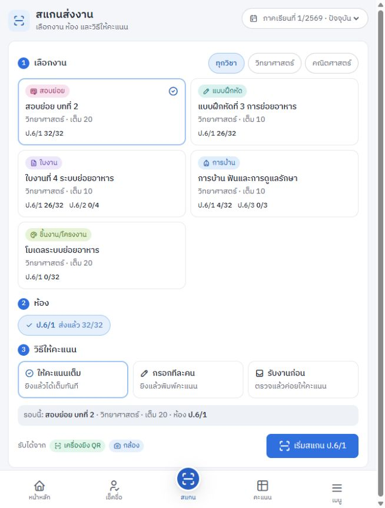

# รายงานตรวจงานครบก่อนส่งมอบคุณครู

**รายงานนี้บันทึกก่อนแก้** — ผลแก้24ต.ค.และสถานะ12ข้อดู [รายงานหลังแก้](../2026-10-24-hardening/verification.md)

**ผลประเมิน: มีพื้นฐานพร้อมพัฒนาต่อและชุดทดสอบเดิมผ่าน แต่ยังไม่ควรใช้เป็นหลักฐานคะแนนเพียงแหล่งเดียวหรือปิดงานส่งมอบจริง** ต้องแก้ความถูกต้องของข้อมูล/กู้คืนก่อน แล้วทดลองหนึ่งห้องบนอุปกรณ์จริง

วันที่ตรวจ 23 ตุลาคม 2569 · เป้าหมาย: ครูหนึ่งคน ใช้ iPad คอมพิวเตอร์ และมือถือ · ขอบเขตปัจจุบัน: local และข้อมูลสมมติ

## 1. ฐานและความน่าเชื่อถือของหลักฐาน

- HEAD `1141caf` บน `main` รวม local changes เดิมทั้งหมด รายการไฟล์และ SHA-256 อยู่ใน [code-state.json](evidence/code-state.json), สถานะ Git อยู่ใน [worktree-status.txt](evidence/worktree-status.txt)
- เริ่มงานพบไฟล์แก้ค้างใน Gradebook, Scan, Students, CSS, lockfile และรายงานเก่า รวม unit tests ที่ยังไม่ track ไม่ได้ลบ/ย้อน/รวมเข้ากับงานนี้
- อ่าน architecture, routes ทุกกลุ่ม, migrations, client flows, offline/backup paths และเอกสารเดิม ตรวจเฉพาะส่วนสำคัญเชิงลึกเพิ่มเติม ไม่อ้างว่า exhaustive security certification หรือค้นพบบั๊กได้ทุกกรณี
- ผู้ตรวจย่อยสามบทบาทให้ผลเบื้องต้น; ต่อมาหยุดเพราะโควตา PM ยืนยันหลักฐานและทำซ้ำเอง ส่วนสรุปสุดท้ายเป็น self-review ยังขาด independent release sign-off
- ไม่เปิดฐาน Cloudflare จริง ไม่อ่าน `.dev.vars` ไม่เรียก deploy/migrate/seed จริง ไม่ตรวจข้อมูลนักเรียนจริง

## 2. Baseline และ coverage

| รายการ | ผล | หลักฐานและข้อจำกัด |
|---|---|---|
| TypeScript | PASS | `npm run typecheck`, exit 0; QA วัด 6.53s |
| Unit/API integration | PASS | `npm test`, exit 0; **45 files / 496 tests**, Vitest duration **46.33s** บน current dirty tree |
| Production build | PASS | `npm run build`, exit 0; QA วัด 7.14s; precache 20 files ราว 3,044 kB |
| Preflight | PASS | `npm run preflight`, exit 0; QA วัด 2.35s; ไม่ตรวจ remote DB/secret configuration จริง |
| Dependency audit | FAIL ตาม audit policy | registry ตอบสำเร็จ แต่ exit 1: **15 affected packages, 9 high / 6 moderate / 0 critical**; ไม่ใช่ 15 exploit ที่ยืนยันกับแอปแล้ว |
| API experiments ใหม่ | FAIL ต่อ expected invariants | บั๊ก 5 สถานการณ์ทำซ้ำได้; [ผล JSON](evidence/reproduction-results.json), [script](evidence/reproduce.cjs) |
| Protected API samples | PASS | bootstrap/gradebook/reports/backup/audit แบบไม่มี cookie ตอบ 401 ทั้งห้าจุด |
| UI local built app | ตรวจบางส่วน | ลงชื่อเข้าใช้และเปิด Home, Scan, Attendance, Gradebook, Reports, Students; อ่าน Random/Settings แต่มี session interference จาก fixture คนละพอร์ต |
| บัญชีว่าง onboarding | ตรวจบางส่วน | เห็น welcome guide จริง; confirm dialog ทำให้ browser automation ค้าง จึงไม่อ้างว่า reproduce flow ข้าม onboarding สำเร็จ |
| Safari/iPad, มือถือจริง, กล้อง, เครื่องพิมพ์ | NOT RUN | ต้องใช้ฮาร์ดแวร์จริง; Chromium pane ไม่แทน Safari/PWA lifecycle |
| Remote health/deployment/restore drill จริง | NOT RUN | ไม่มีการทดสอบ production ในรอบนี้ |
| Browser E2E scripts เต็มชุด | NOT RUN | รอบนี้ไม่ได้รัน scripts/offline/onboarding/camera/rehearsal ทั้งชุดผ่าน browser runner |

การรันครั้งแรกใน sandbox มี EPERM/EACCES และ Workers startup errors จึงได้ 0 tests; เมื่อใช้สิทธิ์ที่อนุมัติสำหรับ loopback/cache กับคำสั่งเดิม tests ผ่านครบ ไม่จัด startup failure ครั้งนั้นเป็นบั๊กระบบ

คำเตือน build: ExcelJS chunk ประมาณ 940 kB และ static/dynamic import ปะปน เป็นงานด้านขนาดไฟล์/การโหลด ยังไม่มี performance measurement บนอุปกรณ์ครูเพื่อยืนยันว่าช้าเกินเกณฑ์

### แผนที่สิ่งที่ตรวจ

| ส่วน | หลักฐานรอบนี้ | สิ่งที่ยังต้องยืนยัน |
|---|---|---|
| Login/setup/devices | source + auth tests + setup race experiment | Safari session/revoke/logout จริง, hardening race ที่พบ |
| Onboarding/term/catalog | source + tests + duplicate term experiment; เห็น welcome UI | first-term fix, empty-state browser flow หลังแก้ |
| Home/Scan/Gradebook | source + existing scan/visibility/logic/API tests + local UI | กล้องจริง, Thai keyboard/HID, หลายแท็บ/หลายอุปกรณ์ขณะเน็ตค้าง |
| Attendance/Random | source + integrity/attSync/random tests; Attendance UI | offline close/reopen บน iPad, late/timezone/period กับครู |
| Students/import/QR | source + import/QR tests + local UI + history experiment | clipboard บน iPad, พิมพ์ QR และสแกนกระดาษจริง |
| Reports/Excel | source + metrics/Excel/report tests + local UI | ตัวเลขต้นฉบับจริงและไฟล์ Excel บนอุปกรณ์ครู |
| Settings/backup/reset | source + backup/restore/reset tests + experiments | complete restore drill บน candidate ที่แก้แล้ว |
| Security/deploy/operations | guards/config/migrations/docs + registry audit | remote limits/config, independent final review |

## 3. ข้อค้นพบเรียงตามผลกระทบ

High = ข้อมูลหลักผิด/ประวัติไม่ครบ; Medium = ความถูกต้องหรือ usability เสียเฉพาะเงื่อนไข; Priority ก่อนทดลองอาจสูงกว่าระดับ severity เพราะราคาการแก้ต่ำและผลต่อครูชัด

| ID | ระดับ | หลักฐาน | ปัญหา | ลำดับ |
|---|---|---|---|---|
| F01 | High | REPRODUCED | ย้ายรหัสนักเรียนเดิมไปปีใหม่แล้วรายงานเก่าเอานักเรียน/คะแนนออก | ก่อนทดลอง |
| F02 | High | REPRODUCED | restore รับคะแนน 999 ที่มากกว่าคะแนนเต็ม และตอบสำเร็จ | ก่อนทดลอง |
| F03 | Medium | REPRODUCED | settings write ที่เริ่มก่อน restore เขียนทับค่าหลัง restore | ก่อนทดลอง |
| F04 | Medium | CODE FINDING | หลาย network path ไม่มี deadline; Wi-Fi ค้างทำให้ bootstrap/sync ไม่จบ | ก่อนทดลอง |
| F05 | Medium | CODE FINDING | ไม่มีเทอมปัจจุบันแล้วเปิด StartTermModal ปุ่มเริ่มถูก disable ตลอด | ก่อนทดลอง |
| F06 | Medium | CODE FINDING | ไม่มีห้องแล้วบางหน้าค้าง loading ไม่มีขั้นต่อไป | ก่อนทดลอง |
| F07 | Medium | REPRODUCED | `/api/terms` สร้างคู่ปี/เทอมซ้ำได้ | ก่อนทดลอง |
| F08 | Medium | REPRODUCED | setup พร้อมกันสร้างครูสองบัญชี ทั้งที่ login อ่าน `LIMIT 1` | ก่อนส่งติดตั้งใหม่ |
| F09 | Medium | CODE FINDING + UI observation | แถวนักเรียนกดด้วยเมาส์ได้ แต่ไม่มี semantics/keyboard path; modal ไม่มี focus lifecycle | ก่อน UAT |
| F10 | Medium | CODE FINDING | คู่มือกู้ข้อมูลยังชี้ `kru-db` แต่ runtime เป็น `kru-db-apac`; schema ใน README เก่า | ก่อนส่งคู่มือ |
| F11 | ต่างกันตามแพ็กเกจ | REGISTRY FINDING + CODE TRIAGE | dependencies มี advisory ต้อง patch/ประเมิน reachability | ก่อน candidate release |

### F01 — ประวัติปีเก่าไม่คงเดิมเมื่อใช้รหัสนักเรียนซ้ำข้ามปี

**วิธีทำซ้ำ:** เริ่มจากห้องเก่า 32 คน/88 submission rows → เปิดปีถัดไปพร้อมห้องใหม่ → import code ของเด็กเดิมเข้าห้องใหม่ → อ่าน gradebook เทอมเก่า

**ผลจริง:** import ตอบ 200; รายชื่อเก่าเหลือ **31 คน** และ submission payload เหลือ **84 rows** เด็กคนนั้นหายจาก payload เก่า ไม่ได้หมายความว่าแถวคะแนนถูกลบออกจากฐานโดยตรง

**สาเหตุ:** `worker/routes/students.ts:206` จับคู่ code ทั้งระบบ, `:235` เปลี่ยน `class_id` ของ record เดิม; `worker/routes/gradebook.ts:55` และ `:69`, `worker/routes/reports.ts:82` และ `:90` กรองด้วย class ปัจจุบัน

เป็นข้อจำกัดที่ README/UI เคยเตือนไว้ แต่ยังทำให้คำรับรองว่ารายงานปีเก่าคงเดิมมีข้อยกเว้นสำคัญ คำเตือนไม่ได้ป้องกันข้อมูลรายงานเปลี่ยน

**แผนรอบแรก:** บล็อก cross-year reimport และการย้ายเด็กที่มีประวัติผ่านทั้ง import และแก้รายคน; อนุญาต reimport ห้องเดิม ไม่สร้าง code ปลอมเพื่อหลบข้อจำกัด ระยะยาวค่อยออกแบบ enrollment history เป็นงานแยก

**ผ่านเมื่อ:** การกระทำที่ยังไม่รองรับตอบ conflict ก่อนเขียน พร้อมรายชื่อที่ต้องตรวจ; รายงาน/Excel ปีเก่าก่อน–หลังเท่ากันทุกแถว

### F02 — atomic restore ยังขาดการตรวจความหมายของข้อมูล

**วิธีทำซ้ำ:** สำรองจาก fixture ที่ปกติ → เปลี่ยน score หนึ่งแถวเป็น 999 → ส่ง validate/chunk/commit ตาม API จริง

**ผลจริง:** commit ตอบ 200 และ query พบ `score > full_score` หนึ่งแถว การเป็นธุรกรรมเดียวป้องกันการเขียนครึ่งชุด แต่ไม่ได้ทำให้ค่าภายในถูกต้อง

**ตำแหน่ง:** `worker/routes/backup.ts:166` รับ `rows: record(unknown)`; `:209` สร้าง inserts; `:242` swap ตรวจ job/count/FK โดยยังไม่มี score/domain guard. migrations ไม่มี CHECK ที่คุม score เทียบ full_score

**ขอบเขตความเสี่ยง:** ผู้ใช้ต้องมีสิทธิ์ restore; นี่เป็น data-integrity gap ไม่ใช่หลักฐานว่าคนนอกที่ไม่ login เขียนคะแนนได้

**แผน:** ตรวจ schema รายตารางก่อน stage และตรวจข้ามตารางใน transaction ก่อน swap: score/status/date/term uniqueness/roster links ตาม invariants ของแอป; คืน `422 invalid_backup` พร้อมตำแหน่งปัญหา ห้ามลดคะแนนเองหรือคืนสำเร็จบางส่วน

**ผ่านเมื่อ:** backup ปกติและ legacy ที่รองรับ restore ได้; backup ผิด domain ถูกปฏิเสธและ live data/epoch ไม่เปลี่ยน

### F03 — restore epoch ไม่ครอบคลุม settings transaction

**วิธีทำซ้ำ:** ให้ PUT settings ผ่าน middleware แล้วหยุดก่อน `DB.batch`; ทำ full restore สำเร็จด้วย snapshot เดิม; ปล่อย settings batch ต่อ

**ผลจริง:** epoch เปลี่ยน **4 → 5**, PUT ตอบ 200 และค่าจาก request เก่ายังถูกเขียนลงฐานชุดใหม่

**ตำแหน่ง:** `worker/routes/catalog.ts:49` ใช้ `DB.batch` ตรง; แตกต่างจาก `batchAtEpoch` ที่ใช้ในหลาย route ส่วน middleware `worker/app.ts:61` ตรวจเฉพาะตอนรับคำขอ

**แผน:** ใช้ epoch guard ใน transaction เดียวกับ settings และ audit; ทบทวน scan-session bookkeeping ที่เขียนนอก guard ด้วย แต่ส่วนหลังยังเป็น follow-up hypothesis ไม่รวมเป็นบั๊กที่ยืนยันแล้ว

**ผ่านเมื่อ:** stale write ตอบ 409 epoch_changed, ไม่มี settings/audit สำเร็จลวง; UI ให้โหลดข้อมูลใหม่และรักษาร่างให้ครูตัดสิน

### F04 — Wi-Fi มีสัญญาณแต่ request ไม่ตอบ

`src/lib/api.ts:26` ใช้ fetch ไม่มี AbortSignal/default timeout; `withTimeout` มีอยู่แต่ `src/app.tsx:39`/`:50` ครอบเฉพาะ auth/me ส่วน loadBootstrap ถัดไปไม่ถูกครอบ; outbox (`src/lib/outbox.ts:143`) และ attendance load (`src/pages/Attendance.tsx:104`) รอ API เดียวกัน

**ผลตามโค้ด:** หาก auth ตอบแล้ว bootstrap ค้าง แอปไม่เข้าสู่ offline fallback; หากส่งคิวค้าง flush อาจไม่คืน control เพื่อ retry ต่อ แม้เบราว์เซอร์อาจ timeout เองในที่สุด แอปไม่ได้กำหนดเวลารอที่ครูคาดการณ์ได้

**แผน:** API deadlines + abort, stale-response guard, fallback/retry UI; write timeout ต้องเป็น “ยังไม่ทราบผล” ไม่ใช่ “ไม่ได้บันทึกแน่นอน”. ทดสอบ ACK หายหลัง server commit และใช้ opId เดิมตอน retry

### F05/F06 — เส้นทางบัญชีใหม่และหน้าว่าง

- F05: `src/components/StartTermModal.tsx:33` กำหนด newYear=true เมื่อ cur ไม่มี; `:55` ต้อง sure=true แต่ checkbox ที่เปลี่ยน sure แสดงเฉพาะ newYear && cur (`:148`) จึงไม่มีทางกดเริ่มได้ใน modal นั้น แก้ให้ confirmation ใช้เฉพาะ rollover ที่มีเทอมเก่า
- F06: Reports (`src/pages/Reports.tsx:33`), Gradebook (`src/pages/Gradebook.tsx:77`), Random (`src/pages/Random.tsx:41`) return เมื่อไม่มี classId ก่อนเปลี่ยน loading state; Attendance (`src/pages/Attendance.tsx:93`) มี pattern ใกล้เคียง ต้องมี empty state “ยังไม่มีห้องเรียน” และปุ่มไปเพิ่มห้อง/กลับ onboarding โดยไม่เปลี่ยนคำว่าไม่มีข้อมูลเป็นกำลังโหลด
- Browser เห็น onboarding บัญชีว่างจริง แต่การยืนยันข้ามติดข้อจำกัด automation; ทั้งสอง finding จึงยังจัดเป็น CODE FINDING ไม่ใช่ browser reproduced

### F07 — เทอมปีเดียวกันซ้ำ

**ผลทดลอง:** POST `/api/terms` ด้วย year/term เดิมแต่ไม่มี id ตอบ 200; query พบคู่ปี/เทอม **2 แถว**

`worker/routes/catalog.ts:75` ตรวจชนเฉพาะ existing record; `migrations/0001_init.sql:55` ไม่กำหนด unique(year,term)

**แผน:** ตรวจทุก create/update และตรวจซ้ำใน transaction; คืน 409 term_exists ไม่ทำ merge/delete ข้อมูลซ้ำเก่าเอง ตรวจข้อมูลก่อนส่ง candidate และหยุดพร้อมรายการ ID ถ้ามีข้อมูลเดิมซ้ำ

### F08 — setup race

**ผลทดลอง:** fresh setup สองคำขอพร้อมกันตอบ **200/200**, teacher table มี **2 แถว**

`worker/routes/auth.ts:57` teacherExists check แยกจาก insert (`:72`) ระหว่างนั้นยัง hash password; login อ่าน `LIMIT 1` (`:99`) ทำให้บัญชีที่ตั้งครั้งหนึ่งอาจเข้าใช้ไม่ได้

**แผน:** atomic guarded insert ที่สำเร็จได้คำขอเดียว ตรวจผลก่อนสร้าง session/device/audit; ผู้แพ้ได้ already_setup ตาม contract เดิม

ต้องรู้ setup code จึงทำ race นี้ได้ ไม่ใช่ unauthenticated takeover โดยไม่รู้รหัสติดตั้ง และไม่สรุปว่าระบบรองรับครูหลายคนจากการมีสองแถว

### F09 — Keyboard และการอ่านด้วย assistive technology

`src/pages/Students.tsx:165` เป็น div onClick ไม่มี button/role/tabIndex/onKeyDown; AX snapshot แสดงชื่อเป็น text ไม่ใช่ตัวควบคุม เปิด drawer ด้วยคีย์บอร์ดไม่ได้ตามเส้นทางนี้ ช่องค้นหา `:121` ใช้ placeholder ไม่มี label ที่คงอยู่

StartTermModal/AssignmentModal และ overlays มี role=dialog บางส่วน แต่ไม่พบ focus trap, restore focus, Escape handling หรือ aria-modal. ใช้ dialog primitive ร่วมและปุ่มเปิดนักเรียนที่มีชื่อชัดเจน; ไม่ใช้ `•••` เป็น accessible name ของคะแนนอย่างเดียว

**ผ่านเมื่อ:** ใช้ Tab/Shift+Tab/Enter/Escape จบ flow หลักได้; focus ไม่หลุดหลัง modal และคืนปุ่มเดิมเมื่อปิด; VoiceOver อ่านชื่อและสถานะสำคัญได้. ยังไม่ใช่ผลรับรอง WCAG ทั้งระบบ

### F10 — คู่มืออาจทำให้ดูแลผิดฐาน

config และ npm DB scripts ใช้ **kru-db-apac** แต่ `docs/OPERATIONS.md:3`, `:39`, `:58` และ README ใช้ **kru-db** ในคำสั่ง reset/time travel; README ระบุ schema 5 แต่ `shared/types.ts:3` คือ **6**, มี migration `0007_teacher_email.sql`

**แผน:** ปรับ setup/deploy/recovery docs ให้ดึงชื่อจาก config หรือระบุฐานที่ตรวจแล้ว ใช้ขั้นยืนยัน account/database/version/backup ก่อน destructive recovery. ตัวอย่าง reset รหัสผ่านควรอยู่ในคู่มือผู้ดูแลพร้อมผลกระทบ ไม่ให้ครูคัดลอกโดยไม่รู้ target

### F11 — Dependencies และขอบเขตผลกระทบ

หลักฐานเต็ม: [npm-audit.json](evidence/npm-audit.json), ตรวจ registry วันที่ 23 ต.ค. 2569

| แพ็กเกจ | ติดตั้ง | การประเมินจาก source และ advisory |
|---|---|---|
| Hono | 4.13.9 | advisory serveStatic middleware bypass; โปรเจกต์ใช้ ASSETS binding ใน `worker/index.ts` และไม่พบ serveStatic ใน source จึงยังไม่พบเส้นทางเข้าถึง defect นี้; patch ขั้นต่ำ 4.13.11 ตาม [advisory](https://github.com/advisories/GHSA-5r4p-p66f-jhc7) |
| Vite | 6.4.3 | dev-tooling บนเครื่อง Windows เป็นขอบเขตที่เกี่ยวข้อง; patch ใน major เดิมขั้นต่ำ 6.4.4 สำหรับ [launch-editor advisory](https://github.com/advisories/GHSA-587h-7wmj-h5pm); ไม่ใช่ runtime ของ Workers deployment |
| Vitest/@vitest/mocker | 4.1.11 | manual mock registration เป็น dev-server surface; patch ขั้นต่ำ 4.1.12 ตาม [advisory](https://github.com/advisories/GHSA-qxg6-89mg-rqv8); ยังไม่ทดสอบ exploit กับ config นี้ |
| ExcelJS → uuid | ExcelJS 4.4.0 | advisory กระทบ v3/v5/v6 พร้อม buffer; source ExcelJS ที่ตรวจเรียก v4 ใน conditional formatting จึงยังไม่พบเส้นทางที่เข้าเงื่อนไขนี้; [รายละเอียด](https://github.com/advisories/GHSA-w5hq-g745-h8pq) |
| Cloudflare plugin/pool/Wrangler → miniflare/sharp/undici; source-map-js, http-cache-semantics, ip-address | ดู raw report | ส่วนใหญ่เป็น toolchain แต่ต้องประเมิน dependency path ทีละตัวก่อนอัปเกรด ไม่ตีความ devDependencies ว่าไม่ bundle ลง client เสมอ เพราะ ExcelJS อยู่ devDependencies แต่ใช้งานใน browser |

ข้อเสนอแก้ของ npm บางรายการเป็น **downgrade ข้ามรุ่น** ของ pool/ExcelJS จึงไม่ควรใช้ `npm audit fix --force` เป็นคำตอบอัตโนมัติ ให้ lockfile owner เดียวเลือก patched compatible patch/minor และรัน regression ใหม่

## 4. UI/UX และการพัฒนาที่เหมาะกับครู

หน้าจอเดิมแบ่งงานหลักค่อนข้างชัด: Home มีทางลัด, Scan เป็นลำดับเลือกงาน→ห้อง→วิธีคะแนน, Attendance ใช้ tile, Gradebook สลับเป็นรายการเมื่อจอแคบ, Reports รวม print/Excel. คงรูปแบบนี้แล้วปรับความชัดเจนและความต่อเนื่อง

| ความสำคัญ | การปรับ | เกณฑ์ตรวจ |
|---|---|---|
| ก่อนทดลอง | แยก “บันทึกในเครื่อง/รอส่ง/บันทึกแล้ว/ต้องตรวจสอบ” ให้ใช้คำเดียวกันทุกหน้า | ครูอธิบายได้ว่ารายการอยู่ที่ใดและต้องทำอะไรเมื่อเน็ตหลุด |
| ก่อนทดลอง | Empty/error/loading/permission ต้องมีข้อความและทางออกทุก flow | บัญชีว่าง, API ช้า, session หมด, กล้องถูกปฏิเสธ ไม่ติด spinner เปล่า |
| ก่อน UAT | เพิ่ม accessible labels และ keyboard/focus ตาม F09 | คีย์บอร์ดคอมและ iPad external keyboard ใช้ flow สำคัญได้ |
| ก่อน UAT | ปรับชื่อ “นำเข้า Excel” ให้สื่อว่าคัดลอกแล้ววาง; retry preview มีปุ่ม ไม่ให้แก้ข้อความเล็กน้อยเพื่อ retry | ครูนำเข้ารายชื่อสมมติได้เองโดยไม่ต้องบอกขั้นนอกหน้าจอ |
| หลังปิด data risks | ตัวเลือกงานชื่อยาวและปุ่มคะแนนซ่อน `•••` มีชื่อเต็ม/คำอธิบายที่แตะหรืออ่านได้ | แยกงานชื่อคล้ายกันได้บนจอเล็ก โดยไม่ต้องเดาจากคำที่ถูกตัด |
| หลังทดลอง | วัดขนาด app/cache, เวลาเปิดหน้า/Excel และประสิทธิภาพบนเครื่องจริงก่อนปรับ bundle | มี baseline อุปกรณ์/เครือข่ายเดียวกัน ไม่ใช้ warning เป็นตัวแทนความช้าจริง |

ภาพจาก local build และข้อมูลสมมติ (viewport pane รอบนี้ ไม่ใช่ iPad hardware):

[สมุดคะแนน](evidence/gradebook-narrow.png) · [รายงาน](evidence/reports-narrow.png) · [นักเรียน](evidence/students-narrow.png)

## 5. สิ่งที่ทำได้ดีและควรรักษา

- Prepared statements และ allowlist table names ใน backup ลดโอกาส SQL injection จาก paths ที่ตรวจ; protected API samples ปฏิเสธคนไม่มี session
- Session cookie ใช้ HttpOnly/Secure/SameSite=Strict, token hash, password hashing และ rate limit; ไม่พบหลักฐานจากรอบนี้ว่าเข้าข้อมูลนักเรียนได้โดยไม่ login
- คะแนนมี idempotency/opId, conflict/epoch handling, queue ordering; attendance มี draft/ACK matching; existing tests ครอบคลุมหลาย race
- Restore staging/atomic swap และ backup fingerprint เป็นโครงสร้างที่เหมาะสม ควรเพิ่ม domain checks บนของเดิม
- Offline service worker versioning และ self-hosted WASM/fonts ช่วยลด external dependency ระหว่างสอน
- มี TRIAL.md, กระดาษเทียบผล, reconciliation และ operations อยู่แล้ว ควรปรับให้ตรงรุ่นและใช้จริง

ข้อสังเกตข้างต้นไม่ใช่ penetration test certification; backup/IndexedDB มีข้อมูลนักเรียนและ QR จึงต้องระบุผู้เก็บไฟล์ การใช้เครื่องร่วม การล็อกเครื่อง และการลบข้อมูลเมื่อส่งคืนอุปกรณ์ในคู่มือส่งมอบ

## 6. AC ของงานสำรวจและสถานะส่งมอบ

| AC | สถานะ | หลักฐาน |
|---|---|---|
| AC-01 system/current state | PASS | context.md, code-state.json, worktree-status.txt |
| AC-02 baseline | PASS | ตารางผลด้านบน; tests 496/496 |
| AC-03 findings มีหลักฐาน | PASS | F01–F11; reproduction script/results และ source locations |
| AC-04 UX/coverage มีขอบเขต | PASS | coverage/UI matrix; ระบุ physical-device และ browser-confirm limitation |
| AC-05 security triage | PASS | raw npm audit + reachability notes; protected routes checks |
| AC-06 implementation/handoff plan | PASS | plan.md, board.md, decisions.md |
| Release readiness | FAIL | ยังไม่แก้ findings; real-device UAT และ independent final review NOT RUN |

**ส่งมอบงานสำรวจใน local แล้ว; ไม่ได้ส่งมอบ production release** งานต่อไปคือ [แผนพัฒนา](plan.md) โดยเริ่มจาก data guards และ restore validation. ปิด fixture servers ที่ทีมเปิดเองแล้ว; ไม่มีการปล่อยบริการสำหรับใช้งานจริงจากงานนี้
