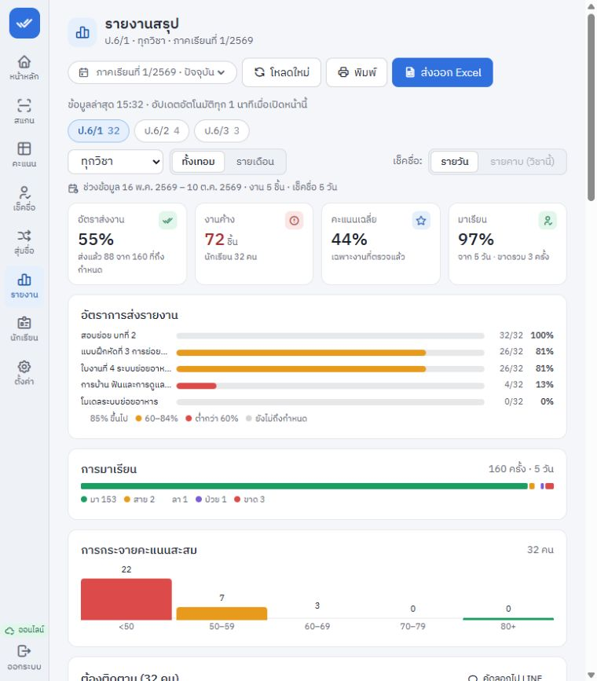

# ผลแก้ข้อค้นพบ — 24 ตุลาคม 2569

**ผลต่อเนื่องล่าสุด:** [ตรวจจำลอง iPad](../2026-10-24-ipad/verification.md) พบและแก้เพิ่ม F13/F14 รวม 14 ข้อ พร้อมผล browser 10 กลุ่มกรณี ตารางด้านล่างเป็นหลักฐานรอบ F01–F12 ก่อนการตรวจต่อเนื่อง

**รายงานเดิม 11/11 ข้อแก้และตรวจใน local แล้ว เพิ่ม F12 หน้ารายงานอัปเดตตามอีก 1 ข้อ รวม 12/12 ข้อ โค้ดค้าง 0 ข้อ**

ยังมี 3 ขั้นตรวจรับภายนอก local: อุปกรณ์จริง, ทดลองหนึ่งห้อง และ release จริง ยอดนี้เป็นคนละประเภทกับข้อบั๊ก ไม่ได้นับกลบว่ายังไม่ deployed หรือยังไม่ผ่าน Safari จริง

## ผลตรวจรวม

| การตรวจ | ผล |
|---|---|
| `npm test -- --reporter=dot` | **PASS 54 files / 554 tests**, exit 0, Vitest 33.98s |
| `npm run typecheck` | PASS exit 0 |
| `npm run build` | PASS exit 0; client build 11.63s, precache ถูกสร้าง |
| `npm run preflight` | PASS config/migration/schema |
| `npm audit --json` | **0 vulnerabilities** หลังอัปเดตและ overrides |
| Excel UUID override compatibility | สร้าง XLSX ที่ใช้ extended conditional formatting ได้จริง 6,308 bytes; Excel unit tests เดิมผ่านในชุดรวม |
| `git diff --check` | PASS; มีเพียงคำเตือน Windows LF/CRLF |
| Browser smoke | login, report load/manual refresh; ขนาดมือถือ390×844และtablet768×1024ไม่มี horizontal page overflow; ภาพจากข้อมูลสมมติใน evidence/ |

หลักฐานคำสั่ง: [tests](evidence/tests.txt), [build](evidence/build.txt), [audit](evidence/npm-audit.json), [code state](evidence/code-state.json)

คำเตือนที่ไม่ใช่ test failure: camera test ตั้งใจจำลอง WASM โหลดผิดจึงมี stderr; build เตือน Excel chunk ราว940 kB และ mixed imports เดิม รวม Rollup comment annotations ของ Zod. Build ใน sandbox เขียน Wrangler log นอก workspace ไม่ได้แต่จบ exit0. Test-pool 0.23 มี deprecation ว่าเปลี่ยนชื่อเป็น vitest-plugin; การย้าย wrapper เป็น maintenance ต่อไป ไม่ใช้ codemod อัตโนมัติในรอบแก้บั๊กนี้

## สถานะแยกทั้ง 12 ข้อ

| ข้อ | สถานะ | การแก้และหลักฐาน |
|---|---|---|
| F01 ประวัติ | PASS LOCAL | history guard ทั้ง import/edit และ preview.blockedMoves; ตรวจซ้ำในธุรกรรม รวม legacy class.year=NULL และ attendance แข่งกับ move; audit-history/audit-review tests |
| F02 Restore | PASS LOCAL | row schemas ก่อนรับchunk, relational/domain guards ใน swap transaction; score,สถานะ,วันที่,FK,เทอม/เลขที่ซ้ำ,ผิดห้อง/ปีถูกปฏิเสธ422โดยข้อมูลเดิม+epochไม่เปลี่ยน; รองรับ legacy fields และ assignment ที่ไม่มีclasslinks; audit-restore-domain/restore/backup-consistency/volume/audit-review |
| F03 Restore epoch | PASS LOCAL | settings+audit,scan sessions,attendance session creation ใช้ epoch guard ในtransaction; stale request ไม่สร้างแม้แต่รอบเช็คชื่อหลังrestore; audit-concurrency/audit-review |
| F04 Network | PASS LOCAL | fetch API มี AbortController:GET8s/write15s,restorechunk30s/commit60s; unknown-write ไม่ retryเอง; outboxยังใช้opIdและส่งต่ออัตโนมัติ; health heartbeatและWASM HEADมีdeadline; audit-api-deadlines/camera/outbox/attSync/backup tests |
| F05 เทอมแรก | PASS LOCAL | ยืนยันsureเฉพาะขึ้นปีใหม่ที่มีเทอมเก่า ปุ่มเทอมแรกกดได้; audit-first-use |
| F06 Empty states | PASS LOCAL | Gradebook/Reports/Attendance/Random แสดงNoClassesพร้อมCTAไปcatalog ไม่ค้างloading; audit-first-use |
| F07 เทอมซ้ำ | PASS LOCAL | guardคู่ปี/เทอม,currentterm snapshot,existing yearในtransaction; ป้องกันsettingsเก่าย้อนปีและIDชนขณะสร้าง; audit-concurrency/audit-review |
| F08 Setup | PASS LOCAL | atomic guarded singleton insert; ผู้แพ้403already_setup ไม่สร้างdevice/sessionปลอม; audit-concurrency/auth |
| F09 Accessibility | PASS LOCAL | Dialogร่วมเข้า/วน/คืนfocus,Escapeตามbusyรวมnested dialogs; native student button,labelssearch/textarea/term/filters/score; audit-dialog/audit-student-import และsource review; ไม่อ้างรับรองaccessibilityทั้งระบบ |
| F10 คู่มือ | PASS LOCAL | README/OPERATIONSตรงkru-db-apac,schema6,migration0007 พร้อมยืนยันtargetก่อนrecovery; ตรวจข้อความและpreflight |
| F11 Dependencies | PASS LOCAL | Hono4.13.13,Vite6.4.5,Vitest4.1.12,plugin1.65,Wrangler4.152,pool0.23,Zod4.6.7; patchedtransitives; uuidoverrideเฉพาะExcelJS11.1.1 (ใช้v4APIเดิม) ทดสอบXLSXจริงและfullsuite; audit0 |
| F12 รายงานอัปเดตตาม (เพิ่ม) | PASS LOCAL | ดึงใหม่60sเฉพาะvisible,กลับforeground/online,ปุ่มโหลดใหม่,เวลาอัปเดต; refreshล้มยังเก็บsnapshotและแจ้งเตือน; filterเปลี่ยนไม่ให้คำตอบเก่าทับ; audit-reports-refresh +browser smoke |

**ระบบเดิมส่งคิวเมื่อเน็ตกลับมามีอยู่แล้วและยังทำงานต่อ** F12 ทำให้หน้าแสดงรายงานดึง snapshot ใหม่ขณะเปิดค้าง ไม่ใช่การแทนระบบsyncเดิม ไม่ใช้WebSocket/push และอาจช้าถึงหนึ่งนาทีเมื่อเปิดค้าง

## Independent review และสิ่งที่แก้ระหว่างตรวจ

- Frontend QA ไม่เขียน application source: เพิ่ม20 tests และพบnestedDialogลำดับfocusผิดจริง PMแก้แล้วทดสอบผ่าน
- Backend reviewer พบracecurrentterm/IDyear/legacyyear/attendanceepoch และrestorelegacy/global/roster/year; เพิ่ม8independent regression cases. PM/ผู้พัฒนาแก้แล้ว testผ่าน; attendance session epochส่วนที่reviewerเขียนเอง PMอ่านguard/catchและชุดรวมยืนยันเพิ่มเติม
- Reviewerพบrestoreทำให้legacy assignmentที่ไม่มีclasslinksกู้ไม่ได้ จึงแก้ให้คงกติกาglobalเดิม พร้อมtestที่บันทึกผ่านAPIจริง→backup→restore
- Fullsuiteหลังรวมการแก้สุดท้ายผ่าน554/554 ครอบคลุมvolumeและbackupconsistency ไม่อ้างผลsubsetก่อนแก้เป็นผลfinal

## ข้อจำกัดหลังแก้ที่ต้องทราบ

1. **ประวัติสมาชิกห้องหลายปี:** รอบนี้ป้องกันการย้ายที่ทำให้รายงานเปลี่ยน ยังไม่มีenrollment history. เด็กมีประวัติหรือข้ามปีย้ายไม่ได้ การreimportห้องเดิมทำได้ตามเดิม ผู้ใช้ยืนยันว่าครูส่วนใหญ่สอนเฉพาะ ป.6 ไม่สอนรุ่นเดิมต่อ จึงไม่ต้องเพิ่มenrollmentก่อนส่งมอบ รูปแบบหลักคือเก็บรุ่นเก่าและเปิดห้องปีใหม่ให้เด็กรุ่นใหม่
2. **ไฟล์สำรองที่ข้อมูลผิดอยู่ก่อนแล้ว:** backupเก่าที่มีคะแนน/เช็คชื่อผิดห้องจากการย้ายในอดีตจะถูกปฏิเสธ422พร้อมตำแหน่ง ต้องตรวจแก้เป็นกรณีไป ระบบไม่ทิ้งหรือเปลี่ยนคะแนนเงียบ ๆ
3. **ข้อมูลซ้ำเดิมในproduction:** ไม่ได้อ่าน/แก้ฐานจริง การกันสร้างซ้ำไม่ได้รวมteacher/termsที่อาจซ้ำอยู่แล้ว ต้องread-only precheckก่อนrelease
4. **อุปกรณ์จริงและห้องเรียน:** Safari/iPad PWA,lifecycle/กล้อง/QRพิมพ์จริง และการเทียบกระดาษ ยังNOT RUNในรอบนี้
5. **ยังไม่ได้deploy:** runtimeที่ครูเปิดใช้งานอยู่ยังไม่เปลี่ยนจากการแก้ในเครื่อง ต้องมีreleaseขั้นถัดไปโดยใช้targetที่ยืนยันและสำรองก่อน

## หน้าจอหลังแก้

[มือถือ](evidence/reports-phone.png) · [แท็บเล็ต](evidence/reports-tablet.png)

ภาพเป็นlayoutจากbuildlocalก่อนfinalcleanuplabelsและbackupguards; การเปลี่ยนท้ายไม่เปลี่ยนlayoutนี้ เวอร์ชันsourceที่ตรวจสุดท้ายระบุในcode-state.json

## ส่งต่อและใช้ต่อ

- สถานะเครื่องอ่านได้: [status.json](status.json) รวม11ข้อเดิม+F12แยกชัด
- ทดสอบซ้ำ: `npm run typecheck`, `npm test`, `npm run build`, `npm run preflight`
- ไม่ต้องเพิ่มmigrationในรอบนี้; schemaยัง6และDBscriptsชื่อเดิมkru-db-apac
- รักษางานเดิมที่ยังไม่commit ไม่reset/stageรวม ไม่commit/push/deployจากงานนี้
- ก่อนทดลองจริงใช้gatesใน [แผนเดิม](../2026-10-23-onboard/plan.md) และ `docs/TRIAL.md` โดยลงผลอุปกรณ์จริงและreconciliation
- ปิดfixtureและmockup preview servers/แท็บชั่วคราวที่ทีมเปิดแล้ว ม็อกอัปในแชตและภาพหลักฐานยังดูได้จากผลส่งมอบ

### อัปเดตการเปิด preview กลับตามคำขอผู้ใช้

24 ต.ค. 2569: ผู้ใช้เปิด `http://127.0.0.1:18564/#/reports` ต่อแล้วเห็นโหลดข้อมูลไม่สำเร็จ ตรวจพบไม่มี process ฟังพอร์ต18564 เพราะทีมปิดfixtureหลังตรวจ จึงเปิดfixtureเดิมกลับ เข้าสู่บัญชีสมมติและโหลดรายงานสำเร็จ (ส่งงาน55%,ค้าง72,คะแนนเฉลี่ย44%,มาเรียน97%) เก็บภาพ `evidence/preview-restored.png`. คงserverและแท็บนี้ไว้ให้ผู้ใช้ทดลองต่อในรอบนี้ ข้อความปิดserverด้านบนเป็นสถานะเมื่อจบรอบก่อน ไม่ใช่สถานะปัจจุบัน และไม่มีการเปลี่ยนข้อมูลproduction
